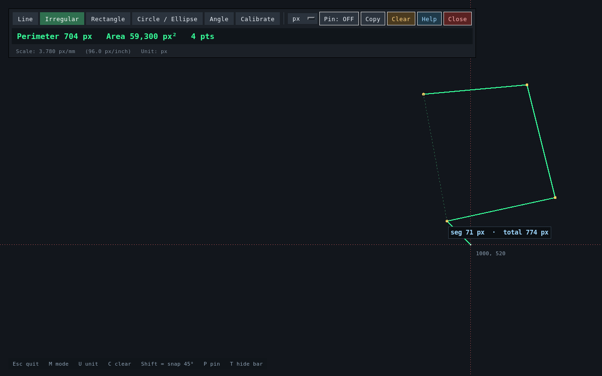

# Onscreen Measuring Ruler — v1.0.0

A Windows app that turns your whole screen into a measuring instrument.
It lays a see‑through overlay over everything, and you drag / click on the screen to
measure **distances, angles, rectangles, circles/ellipses and irregular outlines** —
in **pixels, mm, cm or inches**, with a one‑time calibration so the numbers match
real life.

**Ready to run:** `OnscreenRuler.exe` (Windows 7/8/10/11, 64‑bit, 9.9 MB, no Python
or installation needed). Just double‑click it.



---

## 1. Quick start

1. Double‑click **`OnscreenRuler.exe`**.
2. The screen dims slightly and a toolbar appears top‑left. Everything stays visible
   underneath — the overlay is only ~35 % opaque.
3. Pick a shape button, then drag on the screen.
4. Read the result in the green bar (and on a label drawn next to the shape itself).

### One‑time calibration (needed only for mm / cm / inch)

1. Click **Calibrate**.
2. Drag a line across something whose real size you know — e.g. the long edge of a
   bank card (**85.6 mm**), a coin, a ruler, the width of a USB‑A plug (12 mm).
3. Type the real length, pick mm/cm/in, press **Enter**.
4. Done. The scale (`px/mm`) is saved to
   `%APPDATA%\OnscreenRuler\config.json` and reloaded every time you start the app.

> On a standard 96‑DPI monitor the app already starts at 3.780 px/mm (96 px/inch),
> which is exact for true‑100 %‑scaling displays. If your Windows display scaling is
> 125 %/150 % or you use a different monitor, calibrate once per monitor — the app is
> per‑monitor DPI aware, so it measures true physical pixels.

---

## 2. Modes

| Button | What you do | What you get |
|---|---|---|
| **Line** | drag from A to B (hold `Shift` to snap 0/45/90°) | length, angle, dx, dy |
| **Rectangle** | drag a box | width, height, area, perimeter, diagonal |
| **Circle / Ellipse** | drag from the centre outwards | radius, ⌀, area, circumference |
| **Irregular** | click each corner/bump of the outline, **right‑click** (or `Enter`) to close | total perimeter, enclosed area, vertex count |
| **Angle** | click arm point → vertex → second arm point | angle in degrees (0–180°) |
| **Calibrate** | drag across a known length | new px/mm scale, saved |

Pin **OFF** (default): each new measurement clears the previous one.
Pin **ON**: measurements pile up on screen so you can compare several at once.

---

## 3. Keyboard shortcuts

| Key | Action |
|---|---|
| `Esc` | quit |
| `M` | cycle mode |
| `U` | cycle unit (px → mm → cm → in) |
| `C` | clear everything |
| `Ctrl` + `C` | copy the current result to the clipboard |
| `P` | pin the current measurement and switch Pin ON |
| `Backspace` | undo the last point |
| `←` `↑` `→` `↓` | nudge the moving end by **1 px** (`Shift`+arrow = 10 px) |
| `[` `]` | less / more transparency |
| `T` | hide / show the toolbar |
| `H` or `F1` | help |

---

## 4. How accuracy is guaranteed

* **Whole‑pixel endpoints.** Every point is stored as integer screen pixels; the
  length is the true Euclidean distance `√(dx² + dy²)`, not a bounding box.
* **Per‑monitor DPI aware (v2).** The app asks Windows for physical pixels, so the
  same 100 px measured at 100 % or 150 % scaling is 100 real pixels — and the
  calibration you enter is therefore stable across display scaling.
* **1‑pixel fine tuning.** After placing the moving end, use the arrow keys to walk
  it one pixel at a time until it sits exactly on the edge you want; the read‑out
  updates live. `Shift`+arrow jumps 10 px.
* **45° snapping.** `Shift` while drawing locks the line to horizontal, vertical or
  diagonal, so a "straight across" measurement can't drift off by a pixel or two.
* **Sub‑pixel maths.** mm/cm/inch values keep full floating‑point precision
  (`px / px_per_mm`), only the *display* is rounded.
* **Saved calibration.** A calibrated scale is stored and re‑used, so two
  measurements taken in different sessions are directly comparable.
* **Circles use a true radius** from the centre point, and areas use exact formulas
  (`πr²`, shoelace polygon area, rectangle `w·h`) — no approximations.

Practical tip: to measure a *live* window that keeps changing (video, animation),
freeze it with `Win` + `Print Screen` (screen snip) or take a screenshot and measure
that; for static content just measure straight over it.

---

## 5. Files in this folder

| File | Purpose |
|---|---|
| **`OnscreenRuler.exe`** | the app — the only file you need |
| `onscreen_ruler.py` | readable Python source (same app) |
| `build.bat` | rebuild the .exe on Windows (installs PyInstaller, builds, copies) |
| `selftest.py` | headless test suite that checks every mode's math (28 assertions) |
| `icon.ico`, `icon.png` | app icon |
| `version_info.txt` | Windows file‑version metadata |
| `preview.png` | screenshot used above |

### Running the source instead
```
python onscreen_ruler.py
```
Requires only Python 3.9+ (tkinter is included in the python.org installer).

### Rebuilding the .exe
Double‑click `build.bat`. Or manually:
```
python -m pip install pyinstaller
python -m PyInstaller --onefile --windowed --name OnscreenRuler ^
       --icon icon.ico --version-file version_info.txt onscreen_ruler.py
```

---

## 6. Troubleshooting

**"Windows protected your PC" / SmartScreen.** The .exe is unsigned (code‑signing
certificates cost money). Click *More info → Run anyway*. Some antivirus engines also
flag unknown PyInstaller‑packed executables; if that happens, allow the file or run
the `.py` source instead.

**The overlay measures "wrong" mm values.** You haven't calibrated for this monitor,
or the display scaling changed after calibrating. Run *Calibrate* again.

**Only the main monitor is covered.** Windows full‑screen overlays live on one
monitor; start the app from the monitor you want to measure on.

**Nothing happens when I press keys.** Click once on the overlay first (the app needs
focus for keystrokes); the mouse always works.

**I want to measure at higher zoom.** Zoom the page / CAD view first, then
re‑calibrate — the scale is saved per session, so zoom, calibrate, measure, then set
the zoom back when done.

---

## 7. Notes

* Tested build: Windows x86‑64 GUI executable, Python 3.11 + Tk 8.6, PyInstaller 6.22.
* Config/preferences: `%APPDATA%\OnscreenRuler\config.json` (delete it to reset).
* Licence: MIT — use, modify and share freely.
